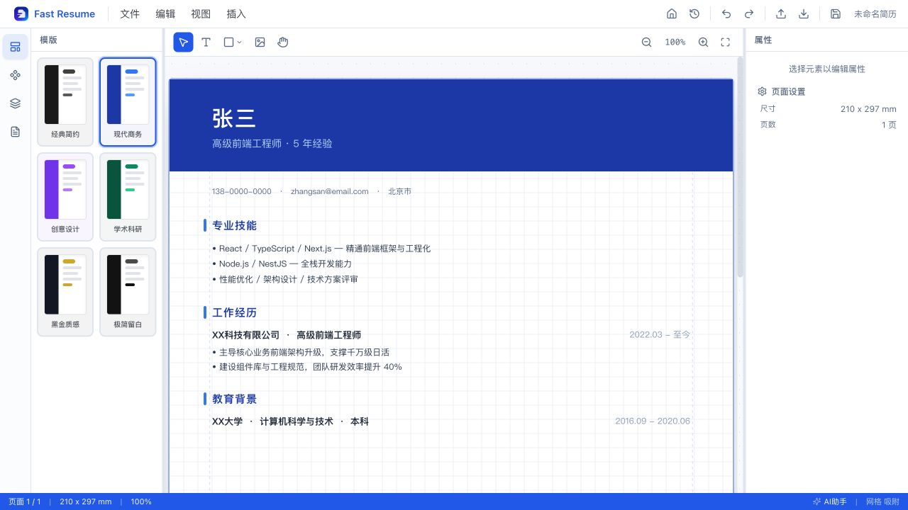
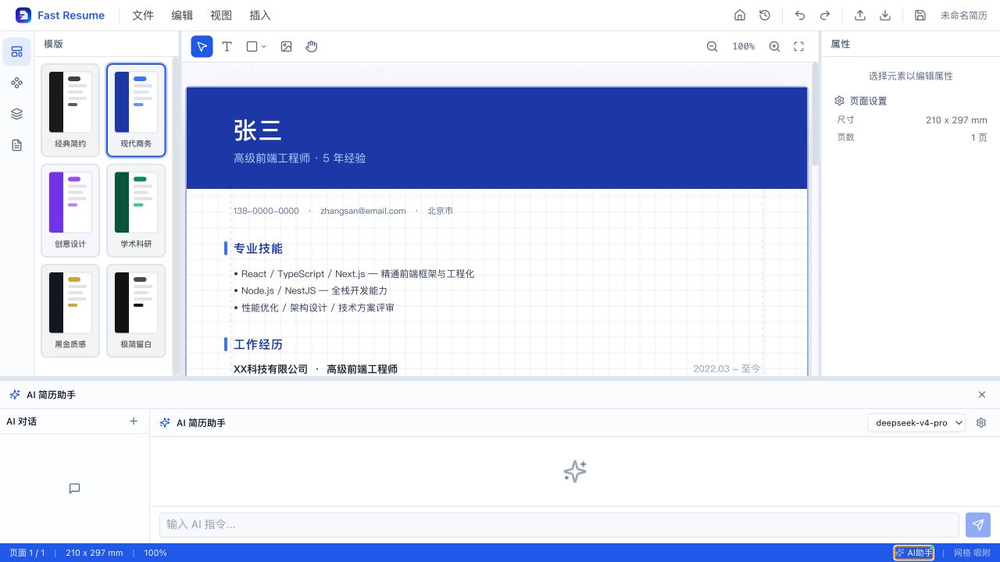
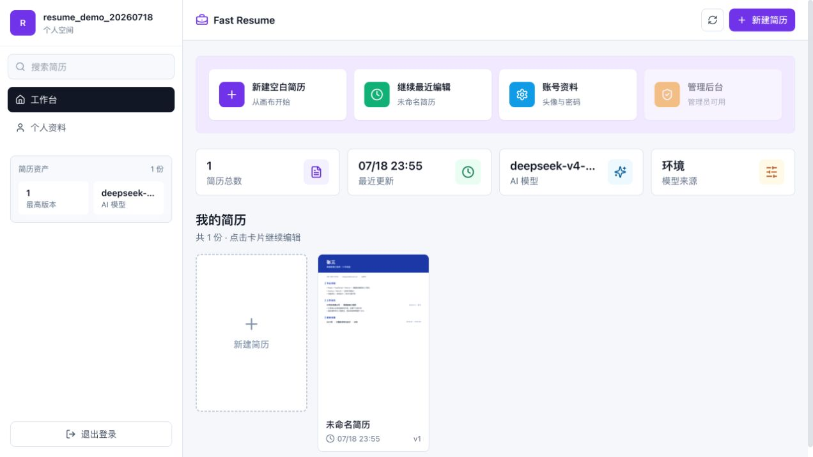
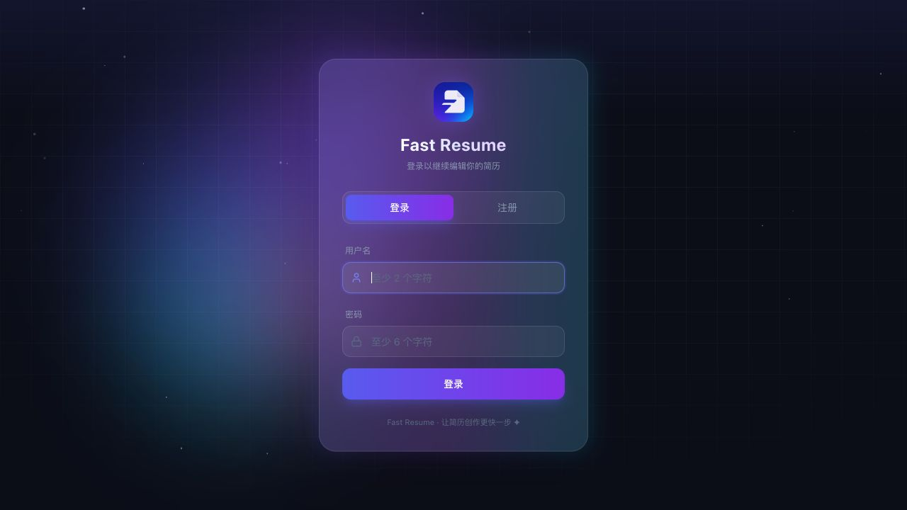

<p align="center">
  
</p>

<h1 align="center">快简历 · Fast Resume</h1>

<p align="center">
  一款面向现代求职者的 AI 画布式简历编辑器。<br />
  像设计工具一样自由排版，让 AI 建议以可审阅、可应用、可回退的方式进入你的简历。
</p>

<p align="center">
  
  
  
  
  
  
</p>

## 预览

### 画布式简历编辑

从模板开始，在 A4 画布上自由调整文本、图片、形状、层级与页面；支持网格、吸附、缩放、撤销和重做。



### AI 简历助手

在编辑器内直接对话，选择快速或深度思考模式。AI 修改以提案形式呈现，可选择应用、拒绝或回退。



<details>
  <summary><strong>查看更多界面</strong></summary>

  <br />

  <p><strong>简历工作台</strong></p>
  

  <p><strong>登录与注册</strong></p>
  
</details>

## 功能亮点

- **自由画布**：基于 Konva 的元素级编辑，支持选择、拖拽、缩放、旋转、锁定、显隐与图层排序。
- **六套内置模板**：经典简约、现代商务、创意设计、学术科研、黑金质感与极简留白，一键应用。
- **丰富组件库**：文本、图片、基础图形、链接和业务图标，可点击插入或拖入画布。
- **AI 辅助改写**：会话管理、模型配置、快速/深度模式、修改提案、应用记录与回退能力。
- **多格式导入**：支持 Markdown、Word（`.docx`）与 PDF 简历解析。
- **多格式导出**：支持 PDF、PNG 与 JSON 备份。
- **可靠保存**：自动保存、手动保存、版本快照、历史恢复，以及网络失败时的本地备份兜底。
- **个人工作区**：账号注册登录、简历资产管理、搜索、缩略图与个人资料设置。
- **管理能力**：管理员可管理用户、角色、密码与系统级 AI 模型配置。

## 技术架构

项目采用 pnpm + Turbo 管理的 TypeScript monorepo：

| Package                  | 职责                                | 主要技术                              |
| ------------------------ | ----------------------------------- | ------------------------------------- |
| `packages/editor`        | 工作台与画布编辑器 UI               | React 18、Vite、Zustand、Tailwind CSS |
| `packages/server`        | 鉴权、简历、版本、导入导出与 AI API | Hono、Node.js、SQLite                 |
| `packages/canvas-engine` | 画布渲染、交互与导出能力            | Konva、React Konva、jsPDF             |
| `packages/shared`        | 跨端类型、转换器和通用工具          | TypeScript                            |
| `packages/templates`     | 内置简历模板与主题                  | TypeScript                            |
| `packages/ai-agent`      | AI 工作流与结构化修改指令           | LangChain、LangGraph                  |

```text
Browser
  └─ React Editor ── Canvas Engine
          │                │
          └──── Hono API ──┤
                   │       └─ PDF / PNG
                   ├─ SQLite + local files
                   └─ AI Agent ── OpenAI-compatible provider
```

## 快速开始

### 环境要求

- Node.js 20 或更高版本
- pnpm 9

### 本地运行

```bash
git clone <your-repository-url>
cd resumeEditor

cp .env.example .env
pnpm install
pnpm dev
```

启动后访问：

- Web：<http://localhost:5173>
- API：<http://localhost:3001>

首次使用请在登录页注册账号。数据库中尚无管理员时，最早创建的账号会成为管理员。

### AI 配置（可选）

基础编辑、模板和导出功能不依赖 AI 配置。若要启用 AI 助手，请在 `.env` 中配置兼容 OpenAI API 的服务：

```dotenv
AI_API_KEY=your-api-key
AI_BASE_URL=https://api.example.com/v1
AI_MODEL=your-model-name
AI_TEMPERATURE=0.2
```

也可以登录后在个人空间或 AI 助手面板中维护模型配置。API Key 属于敏感信息，请勿提交到仓库或截图中。

## 常用命令

```bash
pnpm dev      # 启动所有开发服务
pnpm build    # 按依赖顺序构建所有包
pnpm lint     # 运行 TypeScript 类型检查
pnpm test     # 运行 Vitest 测试
pnpm format   # 使用 Prettier 格式化代码
```

只运行单个包时可以使用 pnpm filter，例如：

```bash
pnpm --filter @resume-editor/editor dev
pnpm --filter @resume-editor/server test
```

## 数据与安全

- 默认数据目录为 `packages/server/data/`，包含 SQLite 数据库、简历文档、缩略图和版本快照。
- 生产环境必须替换 `JWT_SECRET`，并使用足够长的随机值。
- 不要提交 `.env`、API Key、私有简历、生产数据库或本地备份。
- 对公网部署前，建议增加请求限流、文件大小限制、审计日志、HTTPS 与定期备份。

## 参与贡献

欢迎提交 Issue 与 Pull Request。开始开发前请先阅读 [AGENTS.md](AGENTS.md)，并确保相关检查通过：

```bash
pnpm lint
pnpm test
```

UI 变更请在 Pull Request 中附上截图或录屏；行为变更请补充聚焦的 Vitest 测试。

## Roadmap

- [ ] 可共享的只读简历链接
- [ ] 模板市场与自定义模板导入
- [ ] 多语言简历与内容本地化
- [ ] 无障碍与键盘操作完善
- [ ] Docker 镜像与一键部署示例
- [ ] 更完整的端到端测试

## 源码许可与商业授权

Fast Resume 是采用 [PolyForm Noncommercial License 1.0.0](LICENSE) 的**源码可用软件**，不是 OSI 定义下的开源软件。公共许可证仅允许符合条款的非商业使用；未经授权的公司使用、收费服务、客户交付、SaaS、OEM、白标及其他商业用途均不被允许。

- **标准商业授权**：邮件联系作者申请，参考价格为人民币 **¥999 / 年**，实际授权主体、产品、范围和期限以书面确认或签署协议为准。
- **贡献者授权**：提交并合并具有实质价值的 PR 后，可以邮件申请免费商业授权；只有作者书面确认后生效，合并 PR 本身不会自动产生商业权利。
- **非商业使用**：个人学习、研究、实验、公益和符合 PolyForm 条款的教育用途可以依公共许可证使用。

完整规则与申请材料请阅读 [商业授权说明](COMMERCIAL_LICENSE.md)。

- Copyright © 2026-PRESENT [lianzxah](https://github.com/lianzxah)
- 商业授权邮箱：[18834161127@163.com](mailto:18834161127@163.com)

---
