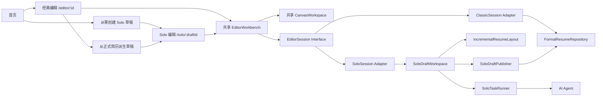
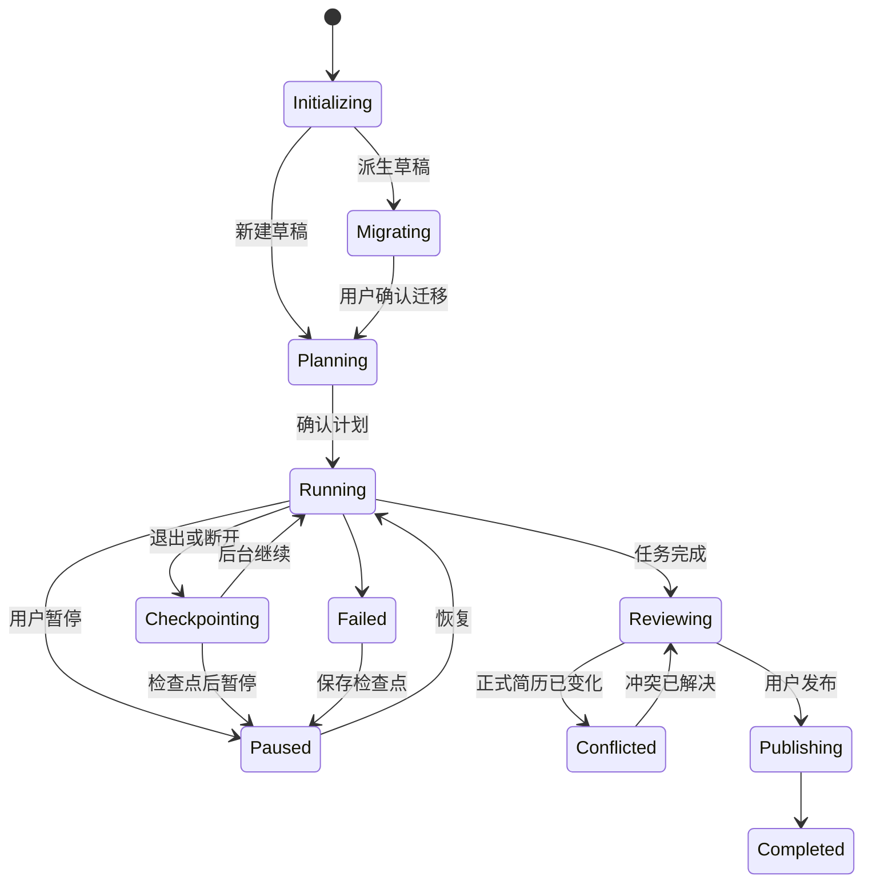

# Solo 简历生成模式架构

状态：已确认，实施中（EditorSession 基础已落地）  
日期：2026-08-02

本文定义 A「任务指挥台」Solo 模式的目标架构。Solo 是一种新的简历编辑模式：它复用现有画布、元素、模板和编辑交互，但使用独立的草稿、任务、布局和发布生命周期。经典编辑模式继续读取正式简历，不能观察到 Solo 的中间生成状态。

相关决策：

- [ADR-0001：使用隔离编辑会话承载 Solo 草稿](../adr/0001-isolate-solo-editing-with-session-adapters.md)
- [ADR-0002：使用客户端权威的增量布局引擎](../adr/0002-use-client-authoritative-incremental-layout.md)
- [ADR-0003：使用三方合并发布 Solo 草稿](../adr/0003-publish-solo-drafts-with-three-way-merge.md)
- [执行计划](../plans/solo-mode-execution-plan.md)

## 目标

- 支持从零生成简历和基于现有简历生成两种入口。
- 复用现有 `CanvasWorkspace`、`ResumeCanvas`、元素节点、模板、属性面板、选择、缩放、吸附、撤销和导出能力。
- Solo 生成过程只写入 Solo 草稿，不触发正式简历的自动保存。
- Solo 与用户可以在不同语义块上同时工作。
- 内容变化、人工拖拽和模板切换能够实时增量回流，保持稳定元素身份和编辑光标。
- 经典模式可以同时修改同一份正式简历；发布时进行三方合并。
- Solo 内部使用细粒度历史，正式简历只记录一次原子发布。
- 页面退出时由用户选择后台继续或检查点后暂停；异常断开默认检查点后暂停。

## 非目标

- 首版不支持多人实时协作编辑同一个 Solo 草稿。
- 服务端不负责像素级最终排版，也不维护第二套字体测量规则。
- Solo 不自动发布，不静默覆盖正式简历或发布冲突。
- 布局引擎不删除、总结或截断用户内容；内容精简属于 Solo 内容规划器职责。
- 首版仍只有一个可跨页的主流式区域；侧栏是有界区域，溢出时返回诊断。

## 已确认的产品决策

| 主题     | 决策                                                 |
| -------- | ---------------------------------------------------- |
| 草稿     | 使用与正式简历隔离的 Solo 草稿                       |
| 入口     | 同时支持从零创建和从现有简历派生                     |
| 并发     | 使用条目级语义租约；用户可编辑其他条目               |
| 布局     | 实时增量布局，不使用整页重建                         |
| 拖拽     | 正文拖拽改变流式顺序或区域；显式操作才固定位置       |
| 密度     | 在模板下限内有界压缩；仍溢出则增加页面并请求内容精简 |
| 迁移     | 进入 Solo 时无损语义化；低置信度内容保留为未分类块   |
| 退出     | 用户选择后台继续或检查点后暂停；异常断开默认暂停     |
| 同时编辑 | 经典模式可以继续修改同一份正式简历                   |
| 发布     | 语义内容、布局约束和自由元素三层三方合并             |
| 模板切换 | 迁移兼容约束，不兼容约束进入预览                     |
| 回流时机 | 局部 RAF 预览 + 120ms 后 Worker 全局回流             |
| 历史     | Solo 细粒度历史 + 正式简历单次原子发布               |

## 实施前约束与当前进展

以下实施前现状决定了不能只新增一个 Solo 页面；其中 Store 与持久化隔离已在 M0/M1 完成：

- [`editor-store.ts`](../../packages/editor/src/store/editor-store.ts) 已改为 Store 工厂，由 `EditorSessionProvider` 持有实例。
- [`useResumePersistence.ts`](../../packages/editor/src/hooks/useResumePersistence.ts) 已委托给正式简历持久化 Adapter；`draft` 会话不会写正式简历。
- [`editor-ai-bridge.ts`](../../packages/editor/src/lib/editor-ai-bridge.ts) 已显式接收目标 Session/Store，不再读取模块级单例。
- [`EditorWorkbench.tsx`](../../packages/editor/src/components/layout/EditorWorkbench.tsx) 已从经典路由抽离，画布和面板可由不同 Session 复用。
- [`resume-data-to-elements.ts`](../../packages/shared/src/utils/resume-data-to-elements.ts) 每次生成完整页面并创建随机页面和元素 ID。
- 当前排版使用固定 A4、单栏常量和字符宽度估算，无法保证字体加载后的分页稳定性。
- `ResumeDocument.resumeData` 和 `ResumeElement.semanticRef` 都是可选字段，旧简历不一定能直接参与语义布局。
- 当前 AI 流式请求与 HTTP 请求生命周期绑定，页面断开后没有持久任务继续执行。
- 正式简历的 SQLite 元数据和本地 JSON/缩略图文件不是一个天然的原子事务。

## 模块视图



### EditorWorkbench

`EditorWorkbench` 只负责组合共享编辑器界面，不拥有文档装载、保存或 AI 生命周期。

```ts
interface EditorWorkbenchProps {
  mode: 'classic' | 'solo';
  slots?: {
    left?: ReactNode;
    right?: ReactNode;
    bottom?: ReactNode;
    canvasOverlay?: ReactNode;
  };
}
```

经典模式继续装配现有左侧面板、右侧属性面板和 AI BottomPanel。Solo 模式装配 A 任务指挥台：左侧任务计划、中央共享画布、右侧执行事件与确认卡片，以及画布锁定覆盖层。

### EditorSession

`EditorSession` 是画布与文档生命周期之间的 seam。Zustand 继续作为内部实现，但不再作为全局单例暴露给所有模式。

```ts
interface EditorSession {
  getSnapshot(): EditorSnapshot;
  dispatch(command: EditorCommand): EditorCommandResult;
  subscribe(listener: EditorListener): () => void;
}
```

Adapter：

- `ClassicEditorSession`：保持现有文档命令、自动保存、撤销和版本语义。
- `SoloEditorSession`：装载草稿、检查语义租约、把正文编辑转换为逻辑内容操作、把拖拽转换为布局约束。
- `InMemoryEditorSession`：用于通过同一个 Interface 测试共享画布和命令行为。

React 使用 `EditorSessionProvider` 和选择器 Hook。现有组件不得通过模块级 `getState()` 绕过当前会话；需要命令式访问的桥接函数接收 `EditorSession` 或 Store 实例。

### SoloDraftWorkspace

`SoloDraftWorkspace` 隐藏草稿装载、操作日志、检查点、租约、布局和发布前审阅。

```ts
interface SoloDraftWorkspace {
  open(draftId: string): Promise<SoloDraftSnapshot>;
  apply(operation: DraftOperation): Promise<DraftApplyResult>;
  control(command: SoloControlCommand): Promise<SoloTaskSnapshot>;
  publish(options: PublishOptions): Promise<PublishResult>;
}
```

生产环境使用 HTTP Adapter，测试使用内存 Adapter。调用方不直接操作草稿表、事件表或布局快照。

### SoloTaskRunner

`SoloTaskRunner` 是持久工作流模块，负责计划、步骤推进、AI 调用、语义租约、事件、检查点和退出策略。它只产生逻辑内容操作，不产生画布坐标补丁。

### IncrementalResumeLayout

`IncrementalResumeLayout` 是纯布局深模块，负责稳定节点身份、文本测量输入、约束求解、密度优化、分页、续页母版和最小布局差异。它不保存数据、不调用 AI、不决定删除哪些内容。

### SoloDraftPublisher

`SoloDraftPublisher` 负责三方合并、冲突审阅结果验证和原子发布。它是唯一允许 Solo 修改正式简历的模块。

## 编辑数据模型

### 正式简历与逻辑内容

分页片段是派生数据，不能成为正文唯一源数据。目标模型在 `ResumeDocument` 中增加可选的流式文档：

```ts
interface FlowDocument {
  blocks: LogicalContentBlock[];
  order: LogicalBlockId[];
  semanticData?: ResumeData;
}

interface LogicalContentBlock {
  id: LogicalBlockId;
  semanticRef?: ResumeSemanticRef;
  content: string;
  segments?: TextSegment[];
  style: LogicalTextStyle;
  layout: LogicalBlockLayout;
}
```

`ResumeData` 继续提供 AI、导入和字段级合并所需语义，但逻辑内容块保存完整富文本和流式排版属性。明确映射的编辑会同步到 `ResumeData`；无法明确映射的富文本不应被结构化数据重建覆盖。

### Solo 草稿

```ts
interface SoloDraft {
  id: string;
  kind: 'new' | 'derived';

  resumeId?: string;
  baseRevision?: number;
  baseDocumentHash?: string;
  baseDocument?: ResumeDocument;

  draftRevision: number;
  document: ResumeDocument;
  constraints: LayoutConstraintSet;
  layoutSnapshot?: LayoutSnapshot;
  unclassifiedBlocks: UnclassifiedBlock[];

  status: SoloDraftStatus;
  executionPolicy: 'foreground' | 'background' | 'checkpoint_then_pause';
  lastEventCursor?: string;
}
```

新建草稿在发布前没有 `resumeId`。派生草稿固定记录创建时的正式简历 revision、hash 和文档快照。

### 操作与变更日志

```ts
interface DraftOperation {
  id: string;
  draftId: string;
  baseDraftRevision: number;
  source: 'user' | 'solo' | 'migration' | 'merge';
  target: SemanticBlockId | FreeformElementId;
  change: SemanticChange | LayoutConstraintChange | FreeformElementChange;
}

interface DocumentChangeSet {
  id: string;
  baseRevision: number;
  resultingRevision: number;
  source: 'classic' | 'solo';
  semanticChanges: SemanticChange[];
  layoutChanges: LayoutConstraintChange[];
  freeformChanges: FreeformElementChange[];
}
```

所有操作携带幂等 ID 和基础 revision。服务端只接受等于当前草稿 revision 的操作，或明确通过语义块级合并验证的非冲突操作。

## 语义租约

稳定租约标识：

```text
personalInfo
summary
skills
certifications
experience/{itemId}
projects/{itemId}
education/{itemId}
custom/{itemId}
```

```ts
interface SemanticLease {
  blockId: SemanticBlockId;
  owner: 'solo' | 'user';
  ownerId: string;
  baseRevision: number;
  acquiredAt: string;
  expiresAt: string;
}
```

规则：

- Solo 只有获得租约后才能写入目标语义块。
- 用户可继续编辑没有被 Solo 占用的条目。
- 用户输入、富文本编辑和拖拽产生短期交互租约，其优先级高于 Solo。
- 租约控制内容写入，不阻止布局引擎移动下游块。
- 结构顺序、模板和全局页面配置使用专门的结构租约。
- 租约失效后，Solo 必须重新基于当前 revision 规划，不得重放旧补丁。

## 增量布局引擎

### 外部 Interface

```ts
interface ResumeLayoutEngine {
  reflow(request: LayoutRequest): Promise<LayoutResult>;
}

interface LayoutRequest {
  flow: FlowDocument;
  template: CompiledLayoutTemplate;
  previous?: LayoutSnapshot;
  constraints: LayoutConstraintSet;
  leases: SemanticLease[];
  density: DensityPolicy;
  targetPageCount?: number;
  revision: number;
}

interface LayoutResult {
  revision: number;
  pages: ResumePage[];
  snapshot: LayoutSnapshot;
  diff: LayoutDiff;
  diagnostics: LayoutDiagnostic[];
}
```

### 布局区域

```ts
type LayoutRegionKind = 'primary-flow' | 'bounded-flow' | 'freeform';
```

- 每个模板首版只有一个 `primary-flow`，可以使用续页母版跨页。
- 侧栏使用 `bounded-flow`，允许排序和密度调整，但溢出时提示用户处理。
- 头像、图标、时间轴和装饰形状位于 `freeform` 区域，默认绝对定位。

### 稳定身份

逻辑节点 ID 由语义身份决定：

```text
experience/{itemId}/title
experience/{itemId}/descriptions
projects/{itemId}/description
summary/body
skills/body
```

分页片段 ID：

```text
fragment:{logicalBlockId}:{role}:{fragmentIndex}
```

同一逻辑内容块跨页后生成多个片段，但片段共享语义块身份。修改一个块不得使无关块的元素 ID 变化。

### 约束

```ts
type LayoutConstraint =
  | FlowOrderConstraint
  | RegionAssignmentConstraint
  | AbsolutePinConstraint
  | FixedWidthConstraint
  | VisibilityConstraint;
```

- 正文上下拖动产生 `FlowOrderConstraint`。
- 拖入主栏或侧栏产生 `RegionAssignmentConstraint`。
- 正文只有显式执行“固定位置”才产生 `AbsolutePinConstraint`。
- 自由画布元素和装饰元素默认使用绝对位置。
- 模板切换保留可移植约束，按区域角色迁移可映射约束，并把不兼容约束放入迁移报告。

### 增量失效与停止条件

1. 比较新旧 FlowDocument、模板 hash、字体 hash 和约束 revision。
2. 找到最早受影响的逻辑节点和区域。
3. 只重新测量脏节点。
4. 从最早脏节点开始重新求解后续几何与分页。
5. 当节点页码、顶部位置、剩余页容量和续页母版状态与旧快照重新一致时停止传播。
6. 输出插入、更新、删除和跨页移动差异，不替换整份页面数组。

### 文本测量

定义内部 `TextMeasurer` seam：

- 浏览器 Adapter 使用 `CanvasRenderingContext2D.measureText`、`FontFaceSet` 和实际字体。
- 测试 Adapter 使用固定字体指标，保证分页断言稳定。

缓存键至少包含字体、字号、字重、字距、行距、宽度和内容 hash。字体尚未加载时可以显示临时布局，但不能标记为最终布局或发布布局。

### 有界密度

布局引擎依次尝试：

1. 压缩区块间距。
2. 压缩条目间距。
3. 在模板下限内降低行距。
4. 在模板下限内降低字号。
5. 从 `comfortable` 切换为 `compact`、`tight`。
6. 仍然溢出时增加页面并返回 `target_page_overflow`。

引擎返回溢出语义块、实际页数、目标页数和建议减少的字符或行数；Solo 内容规划器据此提出可审阅的精简操作。

### RAF 与 Worker

```text
input / drag
  → pending mutations
  → requestAnimationFrame
  → 合并本帧最后变化
  → 测量当前逻辑块
  → 一次 EditorSession 提交

停止输入 120ms / compositionend
  → Worker 增量求解和分页
  → 返回 revision + LayoutDiff
  → 丢弃过期结果
  → requestAnimationFrame 原子应用
```

约束：

- 每帧最多提交一次编辑器状态。
- 中文输入法 composition 期间不触发全局分页。
- 当前编辑块固定左上锚点，保证光标不跳动。
- Worker 不直接访问 DOM；主线程提供字体测量结果或可用的 OffscreenCanvas Adapter。
- 布局结果必须携带请求 revision，过期结果不得写入画布。

性能预算：

- 局部输入预览：单帧内完成。
- 两页简历增量回流：P95 小于 100ms。
- 模板全量重排：P95 小于 300ms。
- 一次 RAF 中只应用一个 LayoutDiff 和一次选区修复。

## 无损语义化迁移

派生草稿打开前执行：

1. 提取文本、富文本、元素几何、层级和现有 `semanticRef`。
2. 根据位置、字体、日期、标题和内容关键词进行视觉分组。
3. 生成逻辑内容块和可明确映射的 ResumeData 字段。
4. 计算每个映射的置信度。
5. 高置信度映射进入迁移预览；低置信度内容保留为未分类块。
6. 用户确认后启动流式布局；正式简历仍保持原文档。

```ts
interface UnclassifiedBlock {
  id: string;
  sourceElementIds: string[];
  originalElements: ResumeElement[];
  confidence: number;
  suggestedTargets: SemanticBlockId[];
  status: 'unclassified' | 'mapped' | 'ignored';
}
```

未分类块保持原坐标和样式，在归类前不允许 Solo 修改。迁移必须能够从草稿中完整恢复迁移前文档。

## Solo 任务生命周期



主动退出弹窗提供：

- “后台继续生成”：服务端继续规划、资料分析、内容生成和校验。
- “暂停并退出”：当前不可中断步骤完成后保存检查点并暂停。

客户端每 5 秒发送心跳。连续 20 秒未收到心跳时，服务端把策略切换为 `checkpoint_then_pause`：允许当前模型调用完成和持久化，但不启动下一步骤。

后台期间不执行像素级最终布局。客户端恢复后读取草稿 revision 和事件游标，使用客户端布局引擎追平并生成最新布局快照。

## 持久化和 HTTP 合同

建议增加：

```text
solo_drafts
solo_operations
solo_events
solo_checkpoints
solo_leases
solo_change_sets
```

文档与布局快照继续存放在本地产物目录，但使用独立的草稿路径，不能复用正式简历文件名或 localStorage backup key。

HTTP 合同：

```text
POST   /api/solo/drafts
GET    /api/solo/drafts/:draftId
POST   /api/solo/drafts/:draftId/operations
POST   /api/solo/drafts/:draftId/control
POST   /api/solo/drafts/:draftId/heartbeat
GET    /api/solo/drafts/:draftId/events
POST   /api/solo/drafts/:draftId/publish
```

操作、控制命令和发布请求都携带幂等 token。事件使用可恢复游标；断线重连先补拉游标之后的事件，再恢复流式连接。

## 三方合并和发布

派生草稿发布使用：

- Base：创建草稿时的正式简历。
- Current：发布时最新正式简历。
- Draft：Solo 草稿。

合并顺序：

1. 按语义块、条目和字段合并逻辑内容与 ResumeData。
2. 按稳定语义 ID 合并布局约束。
3. 按稳定元素 ID 合并自由画布元素和未分类块。
4. 迁移模板、页面配置和模板专属约束。

不同语义块、同块不同字段和相同结果可以自动合并。同一字段不同内容、同一布局属性不同值、删除与修改并发、不同模板选择必须进入冲突审阅。

冲突审阅显示 Base、Current 和 Draft 三份内容及布局预览。用户的解决结果会形成新的草稿 revision，发布前再次检查正式简历 revision。

### 原子发布

`SoloDraftPublisher` 必须协调 SQLite 和本地文件：

1. 验证草稿状态、revision、租约和冲突解决结果。
2. 在临时路径写入新文档和缩略图。
3. 开启数据库事务，创建正式版本记录和 ChangeSet。
4. 原子替换正式文档产物。
5. 提交数据库事务并标记草稿已发布。
6. 任一步失败则保留原正式简历并回滚临时产物。

从零草稿在发布事务中创建新的正式简历资产。派生草稿发布只增加一个正式版本，Solo 内部细粒度历史不进入经典模式的撤销栈。

## 经典模式不受影响的约束

- `/editor/:id` 继续装配 ClassicSession，不读取 Solo 草稿或任务状态。
- ClassicSession 与 SoloSession 不共享 Zustand Store、撤销栈、UI 面板状态或本地备份 key。
- Solo 未发布前，正式简历文档、缩略图和版本号不得变化。
- 经典模式可以继续修改同一正式简历，并产生可供发布三方合并的 ChangeSet。
- 经典 AI 助手继续使用现有对话、提案、应用和回退流程。
- Solo 路由和入口受功能开关控制；关闭开关不改变经典路由行为。
- 共享组件不能通过模式判断绕过 EditorSession；模式差异由 Adapter 和 slot 装配表达。

## 测试策略

测试以深模块 Interface 为测试面：

- `EditorSession`：相同画布命令在 Classic、Solo、InMemory Adapter 上验证各自持久化与租约语义。
- `IncrementalResumeLayout`：稳定 ID、跨页、回流、续页母版、密度阶梯、约束迁移和最小 diff。
- `SemanticMigration`：现有六个模板、Markdown/PDF/DOCX 导入及自由画布旧文档的无损迁移。
- `SoloTaskRunner`：租约竞争、幂等重试、后台继续、心跳超时、检查点恢复。
- `SoloDraftPublisher`：三方合并、冲突审阅、并发 revision 变化和原子失败恢复。
- 编辑器回归：经典路由的装载、自动保存、撤销、AI 应用、导入和导出行为保持不变。

布局测试使用固定字体 Adapter 得到确定性断言，浏览器集成测试再验证真实字体、Canvas 和导出结果一致。

## 可观测性

至少记录：

- Draft 创建、恢复、暂停、后台继续和发布状态变化。
- AI 步骤耗时、模型、重试、token 使用和检查点。
- 租约等待时间和冲突率。
- 布局请求 revision、脏节点数、测量耗时、Worker 耗时、应用耗时和过期结果数。
- 密度等级、实际页数、目标页数和溢出诊断。
- 迁移置信度、未分类块数量和人工修正率。
- 三方合并自动合并率、冲突数量和发布失败阶段。

日志不得包含完整私人简历内容、联系方式、API Key 或上传文件原文。
