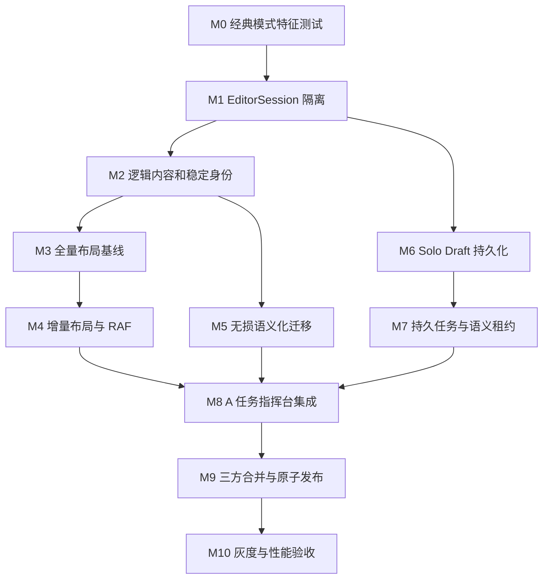

# Solo 模式执行计划

状态：实施中（M0-M3 已完成，M4 基础完成）  
架构依据：[Solo 简历生成模式架构](../architecture/solo-mode.md)

## 实施进度

| 里程碑                | 状态   | 已落地产物                                                                                                                               |
| --------------------- | ------ | ---------------------------------------------------------------------------------------------------------------------------------------- |
| M0 经典模式特征测试   | 已完成 | Editor 独立 Vitest 配置；经典装载、Store 行为、正式持久化、AI bridge、六套模板结构基线共 15 个测试                                       |
| M1 EditorSession 隔离 | 已完成 | Store 工厂、Classic/InMemory Session、Provider/Selector/Commands、共享 EditorWorkbench、正式持久化 Adapter；全局 `getState()` 旁路已清除 |
| M2 逻辑内容和稳定身份 | 已完成 | FlowDocument、逻辑块/分页片段稳定 ID、ResumeData 安全回写、旧备份兼容与新结构验证                                                        |
| M3 全量布局基线       | 已完成 | ResumeLayoutEngine、模板编译、确定性测量、逻辑块分页/拆分、稳定片段物化、自由元素碰撞诊断                                                |
| M4 增量布局与 RAF     | 进行中 | LayoutSnapshot/最小元素 diff、脏块检测、约束迁移报告、Worker 入口、RAF 局部预览、120ms 全局回流、composition/stale revision 保护         |
| M5-M10                | 待开始 | 按依赖图推进                                                                                                                             |

M0/M1 验证记录（2026-08-02）：

- `pnpm --filter @resume-editor/editor test`：6 个测试文件、15 个测试通过。
- `pnpm --filter @resume-editor/editor lint`：通过。
- `pnpm --filter @resume-editor/editor build`：通过；保留现有大 chunk 警告，不阻塞本里程碑。
- 经典编辑路由仍为 `/editor/:id`，装载、快捷键、自动保存和版本历史的用户行为未改变。
- Solo 草稿会话被正式简历持久化 Adapter 显式拒绝，后续 M6 接入独立草稿 Adapter。
- M2 验证：shared 9 个测试文件、64 个测试通过；相同语义输入稳定生成相同逻辑 ID，旧备份无需 FlowDocument 仍可读取。
- M3 验证：canvas-engine 全量布局 fixture 通过；editor 六套官方模板结构基线继续通过。
- M4 当前验证：相同输入产生空 diff，修改单块只标记对应脏块；RAF 合并、compositionend 触发和过期 Worker 结果丢弃均有测试。剩余浏览器真实字体 Adapter、密度阶梯、性能基准和 UI 接线后再关闭里程碑。

本计划按依赖顺序实施 A「任务指挥台」Solo 模式。每个里程碑必须满足退出条件后才能开始依赖它的工作；不允许先把原型页面接到现有全局 Store，再回头补数据隔离。

## 依赖图



## M0：建立经典模式特征测试

实施状态：已完成。

目的：在重构 Store 和持久化 seam 前，固定经典模式当前可观察行为。

任务：

- 为 `packages/editor` 增加 Vitest 配置和 `test` 脚本，并加入根 workspace。
- 覆盖 EditorPage 装载成功、失败和本地备份优先规则。
- 覆盖自动保存防抖、手动保存版本、失败后 localStorage 备份。
- 覆盖选择、拖拽、文本更新、撤销、重做、模板应用和 AI 文档变换。
- 为 `editor-ai-bridge` 增加应用、冲突拒绝和回退特征测试。
- 保存六个官方模板的代表性渲染基线和页面数量基线。

主要文件：

```text
packages/editor/package.json
packages/editor/vitest.config.ts
packages/editor/src/pages/EditorPage.test.tsx
packages/editor/src/hooks/useResumePersistence.test.ts
packages/editor/src/lib/editor-ai-bridge.test.ts
vitest.workspace.ts
```

退出条件：

- 经典模式核心行为有自动化保护。
- `pnpm --filter @resume-editor/editor test` 可独立运行。
- 根 `pnpm test` 包含 editor。
- 当前 lint、build 和已有测试保持通过。

## M1：建立 EditorSession seam

实施状态：已完成。

目的：让经典和 Solo 使用独立编辑会话，同时复用同一画布和面板。

任务：

- 将 `useEditorStore` 的初始化改为 `createEditorStore(initialState)` 工厂。
- 新增 `EditorSessionProvider`、`useEditorSelector` 和 `useEditorCommands`。
- 把 `EditorPage` 的编辑器布局抽取为 `EditorWorkbench`。
- 将共享组件中对全局 `useEditorStore.getState()` 的访问改为当前 Session。
- 把 `editor-ai-bridge` 改为显式接收 Session。
- 将 `useResumePersistence` 拆为会话协调器与正式简历持久化 Adapter。
- 建立 `ClassicEditorSession` 和 `InMemoryEditorSession`。
- 保持 `/editor/:id` 路由、视觉和快捷键不变。

建议目录：

```text
packages/editor/src/editor-session/
  editor-session.ts
  editor-session-context.tsx
  classic-editor-session.ts
  in-memory-editor-session.ts
packages/editor/src/components/layout/EditorWorkbench.tsx
```

风险控制：

- 不在本里程碑引入 Solo 业务状态。
- 不改变 Store Action 的行为，只改变实例所有权和依赖获取方式。
- 每迁移一个共享组件就运行经典模式特征测试。

退出条件：

- 同一测试中可同时创建两个互不影响的 EditorSession。
- ClassicSession 的文档、选区、撤销栈、UI 状态和保存状态不泄漏到其他 Session。
- 经典模式所有特征测试与截图基线通过。

## M2：引入逻辑内容与稳定身份

实施状态：已完成。

目的：建立可编辑源数据和分页片段之间的稳定关系。

任务：

- 在 `packages/shared` 增加 `FlowDocument`、`LogicalContentBlock`、`LogicalBlockId` 和分页片段元数据。
- 定义从现有 `ResumeData` 到 FlowDocument 的适配规则。
- 为经历、项目、教育和自定义段落使用持久 `itemId`。
- 定义确定性的逻辑节点和分页片段 ID。
- 扩展备份格式验证与迁移，兼容没有 FlowDocument 的旧文档。
- 明确逻辑内容修改如何同步可映射的 ResumeData 字段。
- 禁止分页片段成为独立内容源；片段编辑必须回写逻辑内容块。

建议目录：

```text
packages/shared/src/types/flow-document.ts
packages/shared/src/utils/flow-document.ts
packages/shared/tests/flow-document.test.ts
```

退出条件：

- 相同输入多次编译得到相同逻辑节点 ID。
- 修改一个工作经历不会改变其他经历的逻辑节点 ID。
- 旧备份仍可读取，新备份可完整恢复逻辑内容和自由元素。
- ResumeData 映射失败时保留原逻辑内容，不丢失富文本。

## M3：实现全量布局基线

实施状态：已完成。

目的：先用新 Interface 正确替代 `resumeDataToPages()` 的行为，再增加增量优化。

任务：

- 在 `canvas-engine/src/layout` 建立 `ResumeLayoutEngine` Interface。
- 编译模板的主流式区域、有界区域、自由区域和续页母版。
- 实现稳定 LayoutTree、真实文本测量 Adapter、语义块分页和片段物化。
- 实现标题跟随首段、语义块优先整体换页、超长块行级拆分及孤行规则。
- 实现固定续页保护和自由画布碰撞诊断。
- 用固定字体 Adapter 建立确定性测试。
- 对六个官方模板建立布局 fixtures。

建议目录：

```text
packages/canvas-engine/src/layout/
  index.ts
  layout-engine.ts
  layout-types.ts
  template-compiler.ts
  text-measurer.ts
  paginator.ts
  materializer.ts
  diagnostics.ts
packages/canvas-engine/src/layout/tests/
```

退出条件：

- 新引擎能够生成与现有默认结构等价的 A4 简历。
- 内容增长和缩短会正确增加、回收自动续页。
- 自由画布元素不会被自动分页删除或静默移动。
- 页面、逻辑块和未受影响元素身份保持稳定。

## M4：增量布局、混合约束和 RAF

实施状态：进行中；增量快照、diff、Worker/RAF 调度已完成，密度阶梯、真实字体测量和性能验收待补。

目的：支持 Solo 与人工编辑并发时的实时回流。

任务：

- 为 LayoutSnapshot 增加节点几何、页面容量、字体和模板 hash。
- 实现脏节点检测、下游传播和快照重新一致停止条件。
- 实现 `FlowOrderConstraint`、`RegionAssignmentConstraint`、`AbsolutePinConstraint`、固定宽度和显示约束。
- 实现模板约束分类和 `ConstraintMigrationReport`。
- 实现 `comfortable`、`compact`、`tight` 密度阶梯和溢出诊断。
- 增加 Layout Worker 和可序列化请求/结果。
- 主线程使用 `requestAnimationFrame` 合并输入和拖拽变化。
- composition 期间只做局部预览，compositionend 或 120ms 空闲后触发全局回流。
- 通过 revision 丢弃过期 Worker 结果。
- 使用一次 RAF 原子应用 LayoutDiff，并修复选区和活动页。

建议目录：

```text
packages/canvas-engine/src/layout/incremental/
packages/editor/src/workers/resume-layout.worker.ts
packages/editor/src/hooks/useIncrementalLayout.ts
```

性能退出条件：

- 局部输入预览在单帧内完成。
- 两页简历增量回流 P95 小于 100ms。
- 模板全量重排 P95 小于 300ms。
- 连续快速输入不会应用过期结果或造成光标跳动。
- 未受影响元素不会产生无意义 diff。

## M5：无损语义化迁移

目的：允许现有自由画布简历进入 Solo。

任务：

- 优先复用现有 semanticRef 和 ResumeData。
- 按页面位置、字体、层级、日期模式和标题关键词分组旧元素。
- 生成迁移候选、置信度、建议语义目标和布局角色。
- 低置信度内容保存为 `UnclassifiedBlock`。
- 为迁移预览提供接受、重新归类、忽略和恢复原文档操作。
- 在 Solo 草稿内完成迁移；正式简历不写入迁移结果。
- 用现有截图对应的六个模板和手工自由画布文档建立 fixtures。

建议目录：

```text
packages/shared/src/migration/
packages/editor/src/components/solo/SemanticMigrationReview.tsx
```

退出条件：

- 迁移前后所有原始文本、图片、形状和链接均可追溯。
- 低置信度内容不会被自动改写或静默转为自定义段落。
- 取消迁移后草稿能够恢复原始页面和元素。

## M6：Solo Draft 持久化

目的：建立与正式简历隔离的草稿生命周期。

任务：

- 增加 `solo_drafts`、`solo_operations`、`solo_events`、`solo_checkpoints`、`solo_leases` 和 `solo_change_sets`。
- 增加草稿产物目录和独立缩略图/布局快照文件。
- 实现新建草稿和派生草稿。
- 派生草稿保存 base revision、hash 和完整 base document。
- 操作使用幂等 token 和严格 draft revision。
- 建立草稿 HTTP Adapter 与内存测试 Adapter。
- 增加草稿权限校验、大小限制和敏感内容日志保护。

建议目录：

```text
packages/server/src/routes/solo.ts
packages/server/src/services/solo-draft-store.ts
packages/server/src/services/solo-artifact-store.ts
packages/shared/src/types/solo.ts
packages/editor/src/lib/solo-api.ts
```

退出条件：

- Solo 保存不会改变正式简历文档、缩略图或版本号。
- 重复提交同一 operation 不会重复应用。
- 草稿可以在浏览器重启后恢复到相同 revision。
- 新建草稿发布前不会创建正式简历资产。

## M7：持久任务、语义租约和恢复

目的：把当前与 SSE 请求绑定的单轮 AI 调用升级为可恢复 Solo 任务。

任务：

- 定义任务步骤、事件游标、检查点和控制命令。
- AI Agent 只产生逻辑内容操作，不产生页面坐标补丁。
- 实现条目级语义租约和结构租约。
- 用户交互租约优先于 Solo 租约。
- 实现暂停、恢复、取消、重新规划和失败重试。
- 每 5 秒记录客户端心跳；20 秒断开后切换为 `checkpoint_then_pause`。
- 主动退出支持 `background` 和 `checkpoint_then_pause`。
- 重连时补拉事件并从最近检查点继续，不重复已完成步骤。

建议目录：

```text
packages/ai-agent/src/solo/
packages/server/src/services/solo-task-runner.ts
packages/editor/src/hooks/useSoloTask.ts
```

退出条件：

- Solo 与用户可同时修改不同工作经历条目。
- 获取不到租约的步骤进入等待而不是覆盖用户修改。
- 网络断开不会丢失已完成步骤或启动新的计费步骤。
- 幂等重试不会产生重复事件、操作或费用记录。

## M8：集成 A 任务指挥台

目的：把已经验证的 A 原型重写为生产实现。

任务：

- 新增 `/solo/:draftId` 受保护路由和功能开关。
- 首页提供“Solo 生成简历”，现有简历提供“进入 Solo”。
- 左侧显示目标、计划、步骤、素材和租约。
- 中央复用 CanvasWorkspace，增加语义块锁覆盖层和增量回流状态。
- 右侧显示持久事件、事实确认、迁移确认和错误恢复。
- 底部输入补充指令，不复用经典 AI 对话的会话列表。
- 实现暂停/继续、退出选择和恢复提示。
- 删除生产路径对原型模拟状态的依赖；原型继续保留到方案验收完成。

退出条件：

- Classic 和 Solo 页面可在两个标签页同时打开且状态隔离。
- 锁定块不可写，其他块可正常使用现有编辑功能。
- 页面刷新和任务重连后 UI 与服务端状态一致。
- 关闭功能开关后经典模式无路由、布局或包体回归。

## M9：三方合并和原子发布

目的：安全地把 Solo 草稿变成正式版本。

任务：

- 经典模式保存时生成 DocumentChangeSet，不改变原有交互。
- 实现 Base、Current、Draft 三方语义合并。
- 实现布局约束和自由元素合并。
- 实现删除/修改、同字段不同值、不同模板等冲突分类。
- 建立 Base、Current、Draft 内容与布局三栏审阅。
- 冲突解决结果形成新的草稿 revision，并在发布前重新校验正式 revision。
- `SoloDraftPublisher` 使用临时文件、数据库事务和原子替换发布。
- 新建草稿发布时创建正式资产；派生草稿发布时创建一个正式版本。
- Solo 内部历史不写入经典撤销栈。

退出条件：

- 不同语义块并发修改自动合并。
- 同字段冲突不会被静默覆盖。
- 发布过程中任意注入失败都保持正式简历原状。
- 正式版本可以整体恢复到 Solo 发布前。

## M10：灰度、性能和安全验收

任务：

- 使用用户或环境功能开关灰度开放。
- 记录任务状态、租约等待、布局耗时、过期结果、迁移置信度、冲突率和发布失败阶段。
- 日志和埋点执行简历隐私脱敏。
- 对长简历、长中文、英文单词、CJK 标点、富文本、图片和字体缺失进行压力测试。
- 验证后台继续的费用提示、暂停行为和失败恢复。
- 对六个模板进行浏览器预览、PDF 和 PNG 一致性检查。
- 更新 README 截图和用户说明；默认仍进入经典编辑模式。

发布门槛：

- `pnpm lint`、`pnpm test`、`pnpm build` 全部通过。
- 经典编辑关键流程无功能或视觉回归。
- 两页简历布局性能达到 M4 预算。
- 未出现草稿中间态写入正式简历的路径。
- 发布失败恢复、并发冲突和异常断开均通过集成测试。

## 测试矩阵

| 层级          | 重点                                                 |
| ------------- | ---------------------------------------------------- |
| Shared        | 逻辑 ID、操作合并、备份迁移、语义块标识              |
| Canvas Engine | 测量、约束、分页、稳定 ID、最小 diff、密度、模板迁移 |
| Server        | 草稿权限、revision、幂等、任务恢复、租约、原子发布   |
| AI Agent      | 步骤检查点、语义操作、租约等待、溢出后内容精简       |
| Editor        | Session 隔离、RAF、IME、光标稳定、锁覆盖层、退出选择 |
| 集成          | 经典与 Solo 同时编辑、三方合并、刷新恢复、后台继续   |
| 导出          | 画布、PDF、PNG 使用相同分页片段和字体结果            |

## 明确禁止的捷径

- 不允许让 SoloPage 直接使用现有全局 `useEditorStore`。
- 不允许在 Solo 中直接调用现有 `useResumePersistence(resumeId)` 保存正式简历。
- 不允许使用 `resumeDataToPages()` 全量重建并替换所有页面。
- 不允许用画布坐标或随机元素 ID 作为语义租约标识。
- 不允许在 AI Agent 内实现一套服务端分页规则。
- 不允许在布局引擎内删除或总结内容来满足目标页数。
- 不允许发布时使用“最后写入者覆盖”解决经典和 Solo 冲突。
- 不允许把原型组件直接提升为生产实现而不补充 Interface 测试和错误处理。
